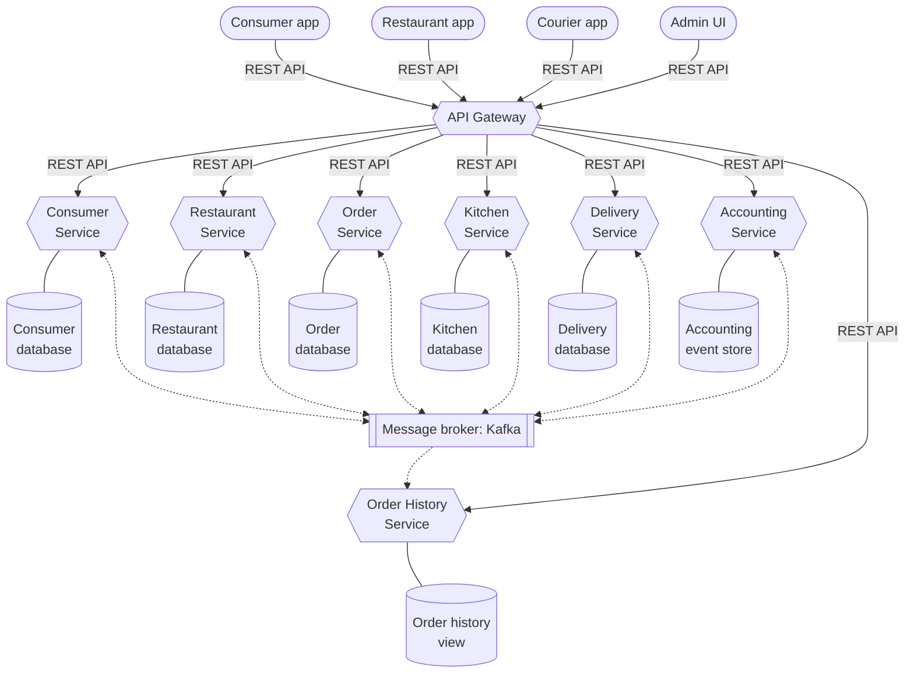
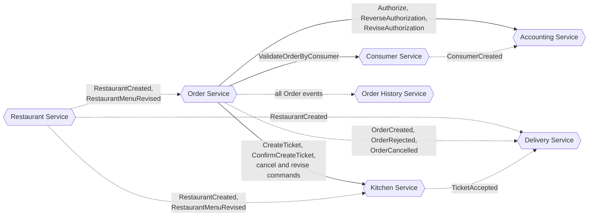
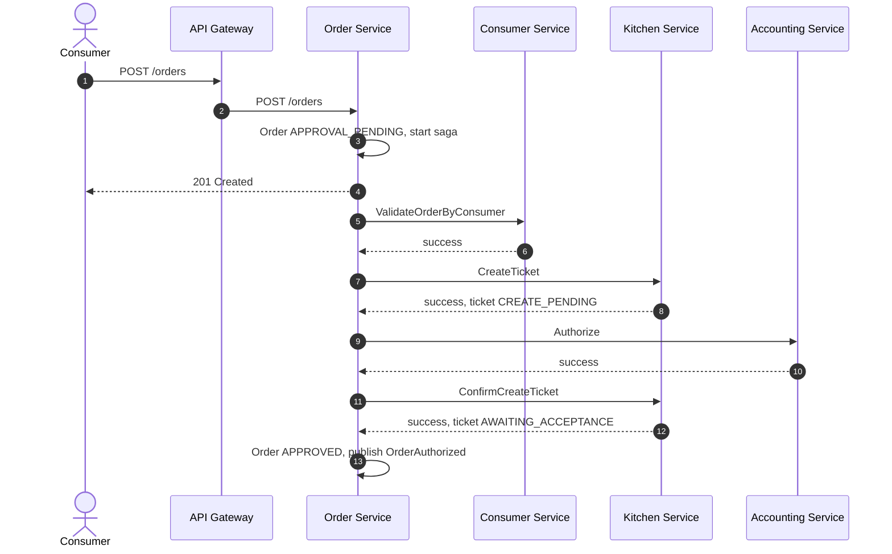
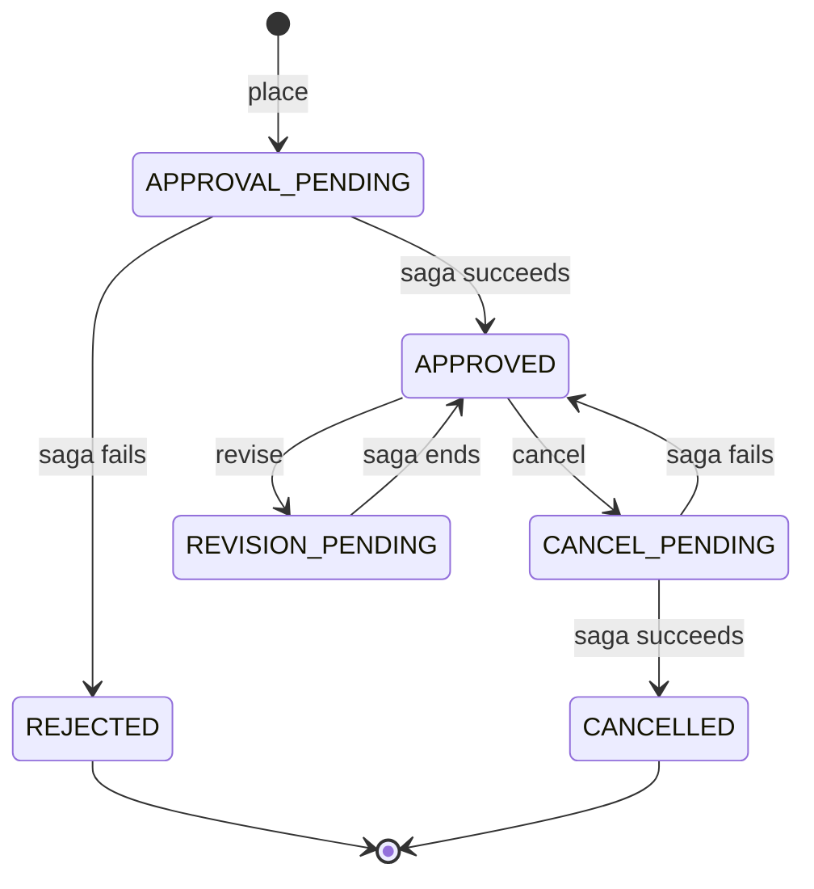
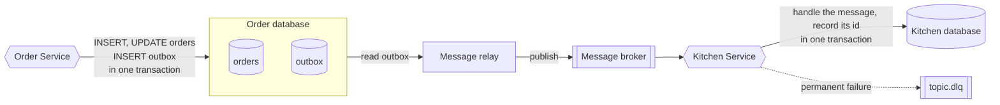
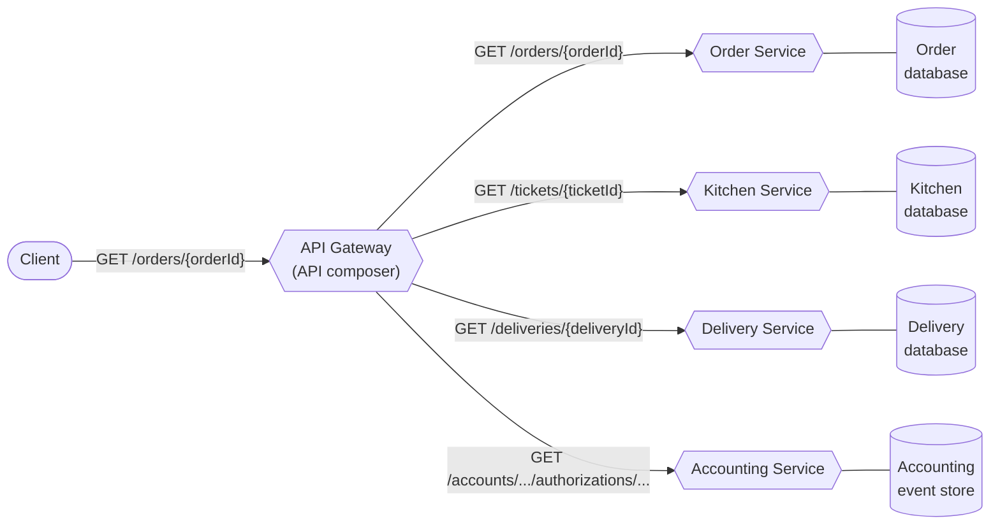
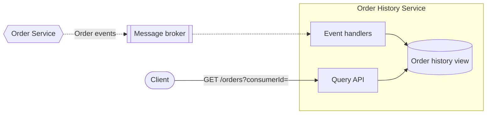
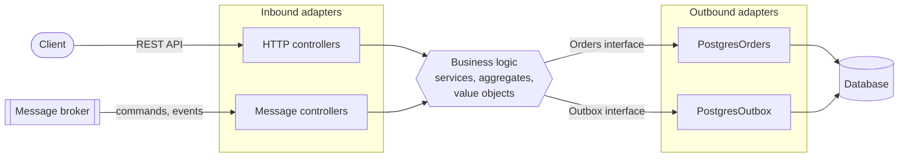

# FTGO

FTGO ("Food To Go") is a food delivery system built as NestJS microservices. Consumers order food from local restaurants, restaurants prepare it, and couriers deliver it.

It rebuilds the example application from _Microservices Patterns_ by Chris Richardson (Manning). The book's reference code is Java and Spring Boot. This project rebuilds it in TypeScript, with every service in NestJS, and puts the patterns from the book into working, production-style code.

## What this project shows

- **Decomposition by business capability.** Seven services, each with its own database.
- **Sagas.** The Order Service orchestrates the Create, Cancel, and Revise Order sagas, with compensating steps and semantic locks.
- **Transactional outbox.** A service saves its data and its outgoing messages in one local transaction. A relay then publishes the messages to Kafka.
- **Idempotent consumers and dead-letter topics.** Each message is handled once. A message that cannot be handled goes to `<topic>.dlq` with the error details.
- **Event sourcing.** The Accounting Service stores each account as a stream of events.
- **CQRS.** The Order History Service keeps a read model that Order events update.
- **API Gateway with API composition.** One entry point for clients. `GET /orders/{orderId}` joins data from four services, with a timeout and a circuit breaker per service.
- **Distributed tracing.** One OpenTelemetry trace follows an order through HTTP, Postgres, the outbox, and Kafka.

## Architecture

Clients talk only to the API Gateway. The gateway forwards each request to the service that owns it. Services never call each other synchronously during a write. They work together through commands and events on Kafka.



Each service is a hexagon with its own database, as in the book. Solid lines are synchronous REST calls. Dotted lines are asynchronous messages.

The next diagram shows who sends which message to whom. The Order Service sends commands to the services in its sagas, and the services publish events about their own aggregates.



Solid arrows are commands. Dotted arrows are events.

Order, Kitchen, and Delivery keep their own read-only copy (a replica) of the restaurant data they need. Restaurant events keep the replicas up to date. So an order can be placed even when the Restaurant Service is down.

## Services

| Service | Port | Owns | Notes |
|---------|------|------|-------|
| API Gateway | 8087 | nothing | Verifies the access token, routes requests, composes order details |
| Consumer Service | 8081 | `Consumer` | Sign-up, sign-in, refresh tokens, profile. Issues the access tokens (EdDSA JWT) and serves the public keys at `/.well-known/jwks.json` |
| Restaurant Service | 8084 | `Restaurant` with its menu | Source of truth for restaurants and menus |
| Order Service | 8082 | `Order` | Places, cancels, and revises orders. Runs the sagas |
| Kitchen Service | 8083 | `Ticket` | The kitchen's view of an order. A restaurant accepts a ticket with a ready-by time |
| Delivery Service | 8089 | `Delivery`, `Courier` | Schedules a delivery and assigns the available courier with the fewest deliveries |
| Accounting Service | 8085 | `Account` | Authorizes payments. Each account is an event stream |
| Order History Service | 8086 | the order history view | Lists a consumer's orders, with filters and pagination |

Each service checks the access token again, and applies its own role and ownership rules. An admin is a consumer account with the `ADMIN` role.

## How an order works

`POST /orders` creates the order in `APPROVAL_PENDING` and starts the Create Order saga in the same transaction. The client gets the order id at once. The saga then runs in the background.



When a step fails, the saga runs the compensating steps in reverse order. For example, when `Authorize` fails, the saga sends `CancelCreateTicket` and then rejects the order.

The `*_PENDING` states are semantic locks. While an order is in a pending state, a saga works on it, and the service refuses other cancel or revise requests for it.



After the order is approved, an admin accepts the kitchen ticket. The Kitchen Service publishes `TicketAccepted`, and the Delivery Service schedules the delivery with a courier.

## Reliable messaging

A service never writes to its database and then publishes to Kafka as two separate steps. If the second step failed, the two would disagree. Instead, every service uses the transactional outbox from `libs/messaging`.



- The relay takes a Postgres advisory lock per batch, so only one replica of a service publishes at a time.
- The receiver retries a temporary failure with exponential backoff. It sends a permanent failure (an invalid message, a broken business rule) straight to the dead-letter topic.
- Every message carries a message id, a correlation id, and the W3C trace context in its headers.

The saga library (`libs/saga`) builds on top of this. It stores each saga's state in a `saga_instances` table, sends commands through the outbox, and reads replies from `order-service.saga-replies`.

## Reading data across services

Two patterns answer queries whose data lives in more than one service.

**API composition.** The API Gateway is the API composer. It calls the provider services and joins their results in memory.



**CQRS.** The Order History Service keeps its own view. Event handlers update the view, and the query API reads it.



- **`GET /orders/{orderId}`**: the gateway calls four services in parallel and joins the results. A slow or failed service does not fail the whole response. Its part is left out and listed in `unavailable`.
- **`GET /orders?consumerId=`**: the Order History Service answers from its own view, with filters and keyset pagination. Event topics keep their messages forever, so the `rebuild` command can replay them and rebuild the view from zero.

## Tracing

Every service and the gateway send OpenTelemetry spans to Jaeger. The trace context goes through HTTP calls, the outbox table, and Kafka headers. So one trace shows a whole saga, including the time a message waits in the outbox.

Every log line inside a span carries its `traceId` and `spanId`, next to the `correlationId`. Open Jaeger at <http://localhost:16686>.

## Inside a service

Each service is a standard NestJS app, organized by feature. It keeps the hexagonal architecture from the book: business logic does not depend on NestJS, Kafka, or the database. Interfaces and ESLint rules keep it that way.



- **Inbound adapters** are Nest controllers, for HTTP and Kafka alike. They validate input with TypeBox and call a service.
- **Services** load an aggregate, call one of its methods, and save it in one transaction. They depend only on interfaces.
- **Aggregates and value objects** hold the business rules. They import no framework or driver code.
- **Outbound adapters** (Postgres, Argon2, JWT, the outbox) implement those interfaces, and the Nest module binds them.

## Tech stack

- **Runtime:** Node.js 24, TypeScript (strict), ESM only
- **Framework:** NestJS
- **Messaging:** Apache Kafka 4 (KRaft mode), with the Confluent client `@confluentinc/kafka-javascript`
- **Storage:** PostgreSQL 17, one database and one role per service, with Kysely as the typed query builder
- **Validation:** TypeBox for HTTP bodies, messages, and environment variables
- **Auth:** Argon2id password hashes, EdDSA access tokens, rotating refresh tokens with reuse detection
- **Errors:** RFC 9457 Problem Details responses, with a stable error `code`
- **Observability:** OpenTelemetry and Jaeger for traces, pino for structured logs
- **Monorepo:** pnpm workspaces and TypeScript project references
- **Local infrastructure:** Docker Compose (Postgres, Kafka, Kafka UI, Jaeger)

## Repository layout

```
apps/
  api-gateway/
  consumer-service/
  restaurant-service/
  order-service/
  kitchen-service/
  delivery-service/
  accounting-service/
  order-history-service/
libs/
  common/      errors, value objects (Money, Address), config, logging, tracing
  contracts/   message and DTO schemas shared between services, no logic
  messaging/   message envelope, outbox, relay, idempotent consumer, Kafka client
  saga/        saga orchestration library
infra/
  postgres/init/      creates one database and one role per service
  kafka/topics.txt    the topics to create (auto-create is off)
docker-compose.yml
```

Services share code only through `libs/*`. A service never imports code from another service.

## Getting started

You need Node.js 24 or later, pnpm, and Docker.

```sh
pnpm install
cp .env.example .env
pnpm keys:generate >> .env      # the key the Consumer Service signs access tokens with
pnpm infra:up                   # Postgres, Kafka, Kafka UI, Jaeger
pnpm build
pnpm -r run migrate             # create the tables in each service database
pnpm -r --parallel run dev:run  # start the seven services and the gateway
```

Each service reads its settings from `.env` at startup and refuses to start when a value is missing or invalid.

| What | Where |
|------|-------|
| API Gateway | <http://localhost:8087> |
| Kafka UI | <http://localhost:9088> |
| Jaeger | <http://localhost:16686> |

Every app has `/health/live` and `/health/ready`. Use `pnpm infra:down` to stop the containers, and `pnpm infra:reset` to also remove their data.

## Try it

These requests go through the gateway. They need `curl` and `jq`.

Register a consumer, and give the account the admin role, so it can add a restaurant:

```sh
GW=http://localhost:8087
curl -s $GW/auth/register -H 'content-type: application/json' \
  -d '{"email":"ada@example.com","password":"correct-horse-battery","firstName":"Ada","lastName":"Lovelace"}'

node --env-file=.env apps/consumer-service/dist/grant-admin.js ada@example.com

TOKEN=$(curl -s $GW/auth/sign-in -H 'content-type: application/json' \
  -d '{"email":"ada@example.com","password":"correct-horse-battery"}' | jq -r .accessToken)
```

Add a restaurant with a menu. Prices are in minor units (cents):

```sh
RESTAURANT=$(curl -s $GW/restaurants -H "authorization: Bearer $TOKEN" -H 'content-type: application/json' \
  -d '{"name":"Ajanta","address":{"street1":"1 Main St","city":"Oakland","state":"CA","zip":"94611"},
       "menu":{"items":[{"id":"chicken-vindaloo","name":"Chicken Vindaloo","price":{"amount":1295,"currency":"USD"}}]}}' \
  | jq -r .id)
```

The Order Service learns about the new restaurant from the `RestaurantCreated` event, so wait a second or two. Then place an order, and read it a moment later. The saga has approved it by then:

```sh
ORDER=$(curl -s $GW/orders -H "authorization: Bearer $TOKEN" -H 'content-type: application/json' \
  -d "{\"restaurantId\":\"$RESTAURANT\",\"deliveryTime\":\"$(date -u -v+1H +%Y-%m-%dT%H:%M:%SZ)\",
       \"deliveryAddress\":{\"street1\":\"9 Elm St\",\"city\":\"Oakland\",\"state\":\"CA\",\"zip\":\"94612\"},
       \"lineItems\":[{\"menuItemId\":\"chicken-vindaloo\",\"quantity\":2}]}" \
  | jq -r .id)

curl -s $GW/orders/$ORDER -H "authorization: Bearer $TOKEN" | jq
```

The response holds the order, its kitchen ticket, its delivery, and its payment authorization. Open Jaeger and pick the `api-gateway` service to see the whole flow as one trace.

On Linux, use `date -u -d '+1 hour' +%Y-%m-%dT%H:%M:%SZ` for the delivery time.

## Code standards

The code is written to read like well-structured Java, while the project structure stays idiomatic NestJS. The full rules live in [`CLAUDE.md`](CLAUDE.md), and ESLint enforces most of them. The main ones:

- Static types everywhere: no `any`, no type assertions, no `@ts-ignore`.
- Object-oriented and SOLID: small classes behind interfaces, composition over inheritance, polymorphism over `switch`.
- Rich domain model: aggregates protect their own invariants, and value objects (`Money`, `OrderId`) replace bare strings and numbers.
- Plain names from the domain language, with no pattern names (`Factory`, `Manager`) and no `I` prefix on interfaces.
- One item per file, and strict TypeBox schemas at every boundary that reject unknown keys.
- Typed errors in a few categories, each mapped to one HTTP status.

Check the code with:

```sh
pnpm typecheck
pnpm lint
pnpm format:check
```

## Roadmap

- Kubernetes manifests, so the whole system runs on a local cluster.
- Courier pickup and drop-off, which add the `PREPARING`, `READY_FOR_PICKUP`, and `PICKED_UP` ticket states.
- A Notification Service for SMS and email.

## Credits

The domain, the service boundaries, and the patterns come from _Microservices Patterns_ by Chris Richardson and its reference application, [microservices-patterns/ftgo-application](https://github.com/microservices-patterns/ftgo-application). The pattern catalogue is at [microservices.io](https://microservices.io/patterns).
